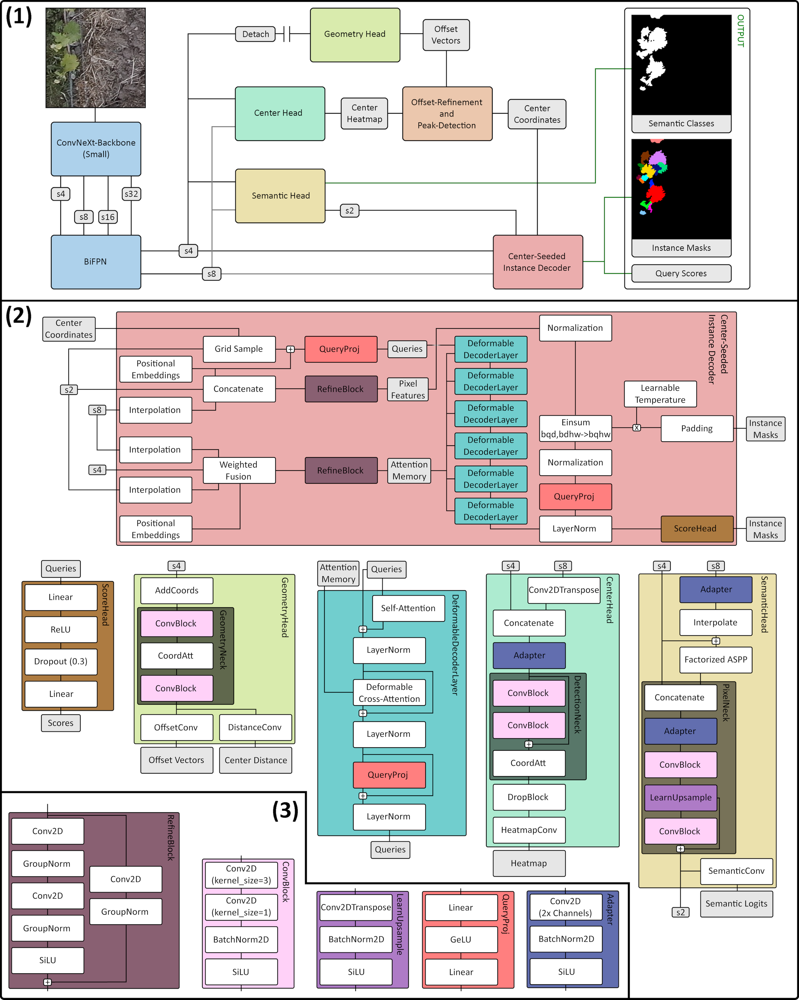
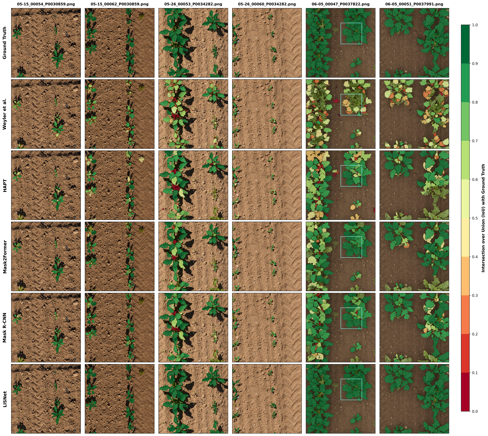

# LISNet: Leaf Instance Segmentation Network with Center-Seeded Instance Decoding

This is the official repository of LISNet by Vahrenhold et al. (2026) as introduced in *[our 2026 paper]()*. 

The dataset produced with the HITL-pipeline is available at *[10.34740/KAGGLE/DS/10636200](https://www.kaggle.com/datasets/janvahrenhold26/vine-leaf-instance-segmentation)*.

## Main Contributions

* We propose the Leaf Instance Segmentation Network (LISNet), a center-seeded architecture that
bypasses standard bounding-box proposals and Region-of-Interest pooling by directly anchoring
deformable cross-attention queries to learned instance centroid topology.
* We formulate a decoupled query mechanism that bridges autonomous inference and interactive annotation. 
By treating network-predicted centroids and external spatial point prompts as functionally
interchangeable query seeds, LISNet operates natively both as a high-throughput automated segmentation 
model and as an interactive refinement tool.
* We introduce an iterative human-in-the-loop (HITL) dataset curation framework featuring
structural safeguards against model bias self-reinforcement, alongside a new, densely annotated 
UAV vineyard dataset.
* We validate the architectural generalizability and robustness of LISNet through extensive evaluations 
across three distinct botanical morphologies (sugar beets, cauliflower rosettes, and vertical 
grapevine canopies), accompanied by multi-tiered occlusion analyses and rigorous ablation studies.

## Model Architecture




## SOTA performance

Direct comparison of LISNet to other state-of-the-art approaches trained and tested on the PhenoBench benchmark by [Jan Weyler et al.](https://www.phenobench.org/). The task type **Inst.** describes *Leaf Instance Segmentation*, while **Pan.** denotes *Hierarchical Panoptical Segmentation*. Architectures marked with **Hidden** were evaluated on the official PhenoBench *Hidden Test Set*, whereas approaches with **Local** were evaluated using a *Local Test Set*. 

*The best values are highlighted in **bold** and were achieved by LISNet with test-time augmentations (TTA).*

| Model | Task | $\mathrm{PQ}_{\mathrm{leaf}}$ | $\mathrm{mAP}$ | $\mathrm{AP}_S$ | $\mathrm{AP}_M$ | $\mathrm{F1}_{\mathrm{center}}$ | $E_{\mathrm{loc}}$ | Evaluation | Source |
| :--- | :--- | :---: | :---: | :---: | :---: | :---: | :---: | :---: | ---: |
| LeafInst | Inst. | -- | 0.50 | -- | -- | -- | -- | Local | [Luo et al., 2026](https://arxiv.org/abs/2603.03616) |
| YOLOv8 | Inst. | -- | 0.46 | -- | -- | -- | -- | Local | [Luo et al., 2026](https://arxiv.org/abs/2603.03616) |
| YOLOv11 | Inst. | -- | 0.46 | -- | -- | -- | -- | Local | [Luo et al., 2026](https://arxiv.org/abs/2603.03616) |
| MaskDINO | Inst. | -- | 0.51 | -- | -- | -- | -- | Local | [Luo et al., 2026](https://arxiv.org/abs/2603.03616) |
| ZeroPlantSeg | Pan. | 41.6 | -- | -- | -- | -- | -- | Local | [Xing et al., 2025](https://arxiv.org/abs/2509.09116) |
| Weyler et al. | Pan. | 42.6 | -- | -- | -- | -- | -- | Hidden | [Darbyshire et al., 2023](https://arxiv.org/abs/2310.06582) |
| HAPT | Pan. | 46.8 | -- | -- | -- | -- | -- | Hidden | [Darbyshire et al., 2023](https://arxiv.org/abs/2310.06582) |
| Mask2Former | Inst. | 57.5 | -- | -- | -- | -- | -- | Hidden | [Weyler et al., 2024](https://www.ipb.uni-bonn.de/pdfs/weyler2024tpami.pdf) |
| Mask R-CNN | Inst. | 59.8 | -- | -- | -- | -- | -- | Hidden | [Weyler et al., 2024](https://www.ipb.uni-bonn.de/pdfs/weyler2024tpami.pdf) |
| H. Mask2Former | Pan. | 66.9 | -- | -- | -- | -- | -- | Hidden | [Darbyshire et al., 2023](https://arxiv.org/abs/2310.06582) |
| linnchong | Inst. | 71.4 | -- | -- | -- | -- | -- | Hidden | [Linnchong, 2026](https://www.codabench.org/competitions/14022) |
| LISNet | Inst. | 72.0 | **0.63** | **0.58** | **0.83** | **0.90** | **0.74** | Local | Ours |
| LISNet | Inst. | -- | -- | -- | -- | -- | -- | Hidden | Ours |
| **LISNet + TTA** | **Inst.** | **74.4** | -- | -- | -- | -- | -- | **Hidden** | Ours |



## Citation
If you find this code, the HITL pipeline or our Inference Engine useful in your research, please cite our work:

  ```bash
  @article{vahrenhold_lisnet_2026,
    title={LISNet: Leaf Instance Segmentation Network with Center-Seeded Instance Decoding},
    author={Jan Richard Vahrenhold and Rebecca Höfle and Daniel Heßdörfer and Tobias Ullmann and Melanie Brandmeier},
    journal={},
    year={2026},
    doi={}
  }
  ```